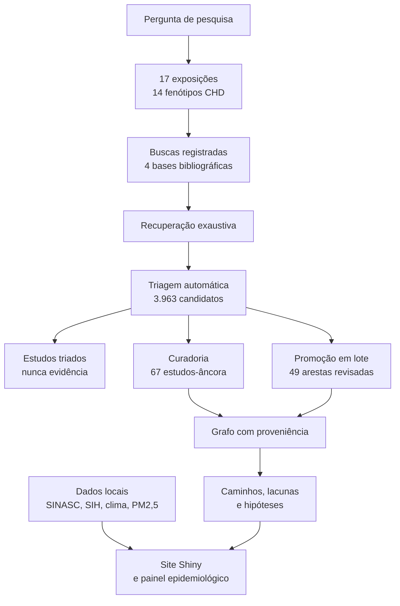
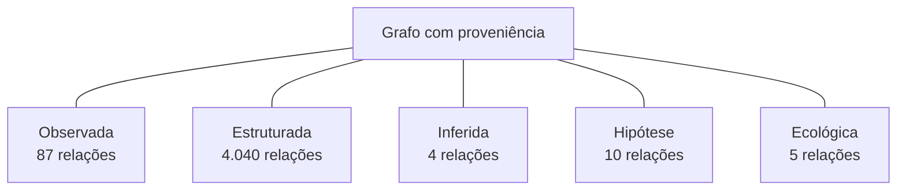
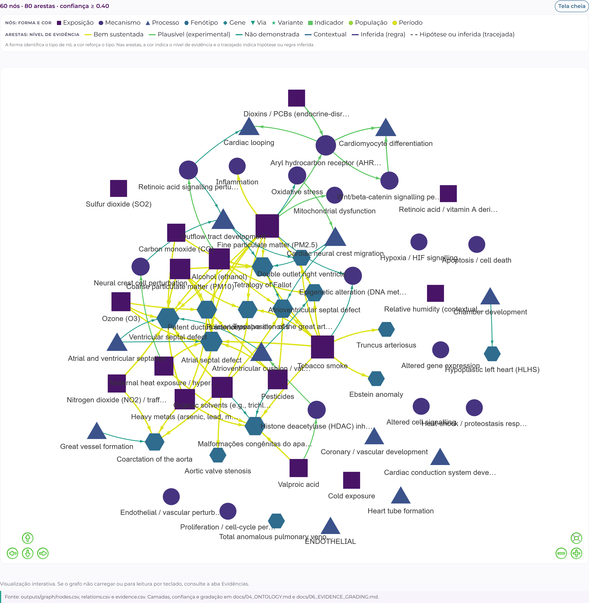
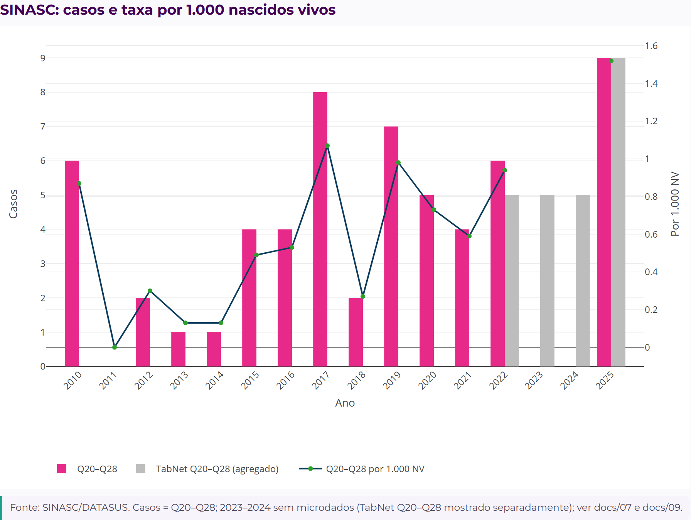
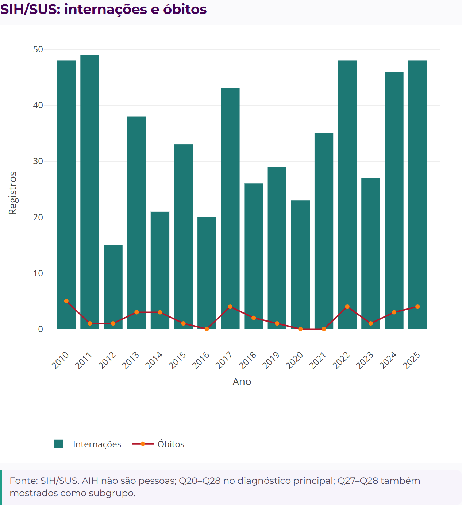
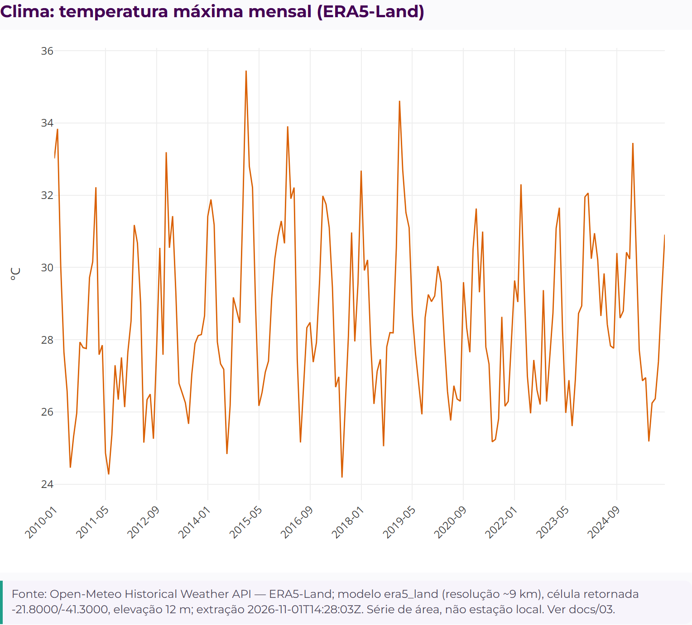
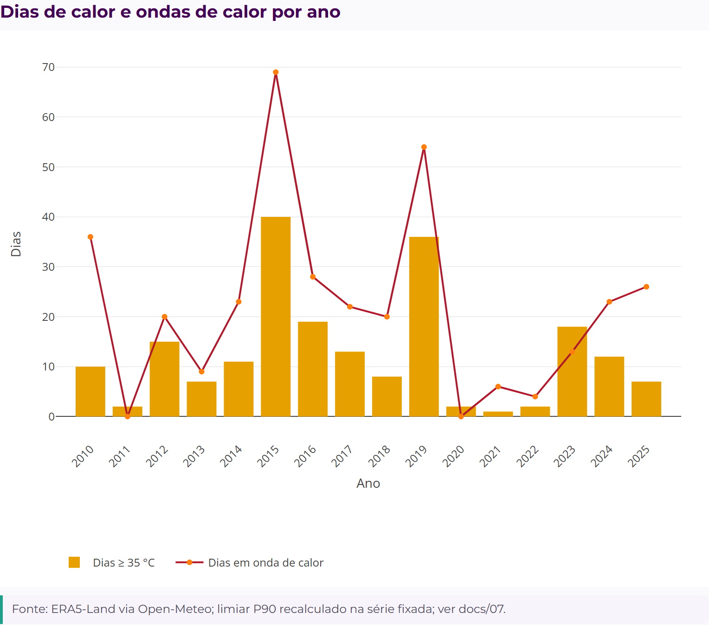
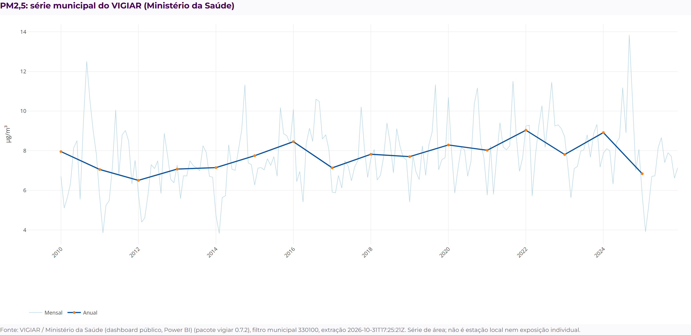
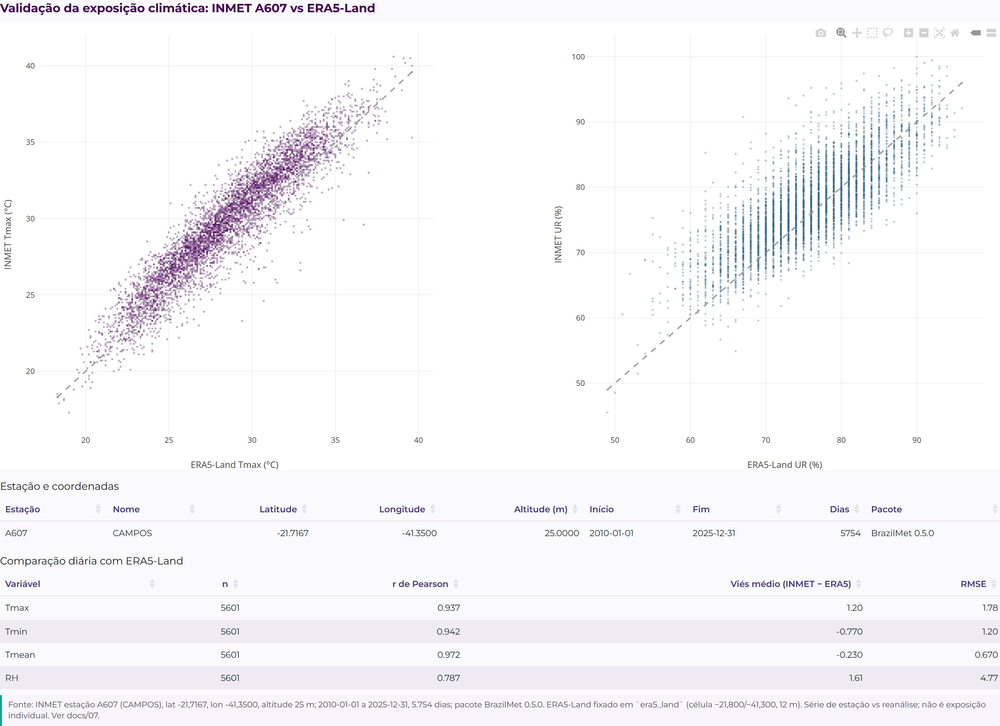

# GraphAmbiCardio

**Um grafo de conhecimento com proveniência sobre exposições ambientais, mecanismos moleculares, cardiogênese e malformações congênitas do aparelho circulatório (CID-10 Q20–Q28).**
Campos dos Goytacazes, RJ, 2010 a 2025.

[](CHANGELOG.md)
[](pyproject.toml)
[](renv.lock)
[](julia/Project.toml)
[](https://github.com/santosry/GraphAmbiCardio/actions/workflows/ci.yml)
[](LICENSE)
[](fair/metadata.json)
[](https://ryansantospaulo.shinyapps.io/graphambicardio/)
[](#11-limitações-honestas)
[](tests)

> **Em uma frase:** o GraphAmbiCardio organiza, em um só lugar, o que a ciência sabe sobre como o ambiente (calor, poluição do ar, agrotóxicos, metais, álcool, tabaco e outros fatores) pode influenciar o desenvolvimento do coração e dos grandes vasos do bebê, e mostra onde ainda faltam evidências.

> **Este estudo não é uma revisão sistemática.** É uma busca organizada, com curadoria documentada, bases biológicas públicas e análise de dados de saúde de Campos dos Goytacazes. Não prova causalidade.

---

## Comece por aqui

| Se você quer... | Vá para |
|---|---|
| Ver o resultado sem instalar nada | [aplicativo publicado](https://ryansantospaulo.shinyapps.io/graphambicardio/) |
| Entender o projeto em 2 minutos | [seção 1](#1-a-pergunta-em-linguagem-simples) |
| Saber de onde vem cada estudo | [seção 2](#2-de-onde-vêm-os-estudos-a-trilha-de-proveniência) |
| Ver os números do grafo | [seção 3](#3-o-que-o-grafo-contém) |
| Olhar as figuras | [seção 6](#6-figuras) |
| Reproduzir o pipeline | [seção 8](#8-reprodutibilidade) |
| Conferir a auditoria | [seção 9](#9-auditoria-e-verificação) |
| Conhecer os limites | [seção 11](#11-limitações-honestas) |

---

## Como ler este repositório

O repositório segue uma linha de raciocínio única: pergunta, busca, triagem, curadoria, grafo, análise, site e limites. Cada etapa tem um artefato verificável.



**Cinco regras que o projeto nunca quebra:**

1. **Toda aresta tem fonte.** Sem referência e trecho verbatim, a aresta não entra.
2. **Hipótese não é evidência.** A camada de hipóteses fica fora de caminhos, centralidade e conclusões.
3. **Triagem automática não é curadoria.** Os 3.963 estudos triados vivem em uma camada separada.
4. **Dado individual não é redistribuído.** O site mostra apenas agregados.
5. **Nenhum resultado é apresentado como causal.** Modelos locais são exploratórios e passam por correção de multiplicidade.

---

## 1. A pergunta, em linguagem simples

**O problema.** Cardiopatias congênitas são alterações na formação do coração que aparecem antes do nascimento. Fatores ambientais podem contribuir, mas a ciência ainda tem muitas lacunas e a evidência está espalhada entre epidemiologia, toxicologia, biologia do desenvolvimento e genética.

**A pergunta.** Quais ligações entre exposição ambiental e cardiopatia congênita têm apoio humano direto? Quais cadeias mecanísticas são apenas experimentais? Onde a evidência converge e onde faltam estudos? O que os dados locais acrescentam, e com quais limites?

**O que o projeto faz.**

| Faz | Não faz |
|---|---|
| Organiza estudos, genes, fenótipos e dados locais em um grafo navegável | Não afirma que uma exposição "causa" cardiopatia em uma pessoa |
| Mostra a fonte, o trecho e o nível de evidência de cada ligação | Não substitui avaliação médica |
| Separa evidência observada, anotação estruturada, inferência, hipótese e contexto ecológico | Não usa dados individuais no site |
| Mede cobertura de busca, lacunas e robustez dos modelos | Não se apresenta como revisão sistemática |

---

## 2. De onde vêm os estudos: a trilha de proveniência

Esta é a parte que mais importa para a credibilidade do grafo. Cada estudo percorre um caminho explícito, e cada etapa deixa um arquivo próprio.

### 2.1 Buscas registradas

As consultas foram definidas antes da coleta: 17 exposições, 14 fenótipos de cardiopatia congênita e o cruzamento entre eles.

| Base | O que foi usado | Como entrar no projeto |
|---|---|---|
| PubMed/MEDLINE | 5 buscas por domínio e 123 buscas por par exposição x fenótipo | metadados e resumos via E-utilities |
| Europe PMC | 5 buscas por domínio, descoberta independente | API REST |
| SciELO | 5 consultas via Crossref, prefixo DOI 10.1590 | metadados |
| CAPES | 4 consultas ao Catálogo de Teses e Dissertações | API pública, todas as páginas |
| Bases biológicas | HPO, ClinVar, NCBI Gene, Reactome, Enrichr | anotações curadas |

Detalhes de cada string, data e contagem: `docs/02_SEARCH_STRATEGY.md` e `literature/searches/*.json`.

### 2.2 Recuperação e triagem

Primeiro foi feita uma busca top-N, que deixou uma assimetria declarada. Depois, todas as consultas foram recuperadas por completo.

| Base | Hits totais | Recuperados na busca original | Recuperados na busca exaustiva |
|---|---:|---:|---:|
| PubMed, domínios | 25.442 | 498 | 25.406 |
| PubMed, pares | 666 | 513 | 663 |
| Europe PMC | 4.789 | 439 | 4.789 |
| SciELO via Crossref | 83.157 | 500 | 83.157 |
| CAPES Teses | 560 | 560 | 560 |

O registro bruto tem **2.510 linhas**, **540 duplicatas** e **1.970 registros únicos**. A triagem automática gerou **3.963 estudos candidatos** e **13.723 relações estudo a conceito**; **638** têm fenótipo de cardiopatia congênita detectado.

> **Importante:** essa camada automática (**Estudos triados**) é uma ferramenta de priorização. Ela não entra em `evidence.csv`, não entra em caminhos e não entra em conclusões. O arquivo é `outputs/graph/screened_studies.json`, descrito em `reports/screened_studies.md`.

### 2.3 Curadoria manual

Os estudos-âncora foram lidos, e cada aresta exige um trecho verbatim do resumo ou do texto completo.

| Item | Quantidade |
|---|---:|
| Estudos-âncora | **67** (66 PMIDs + 1 tese CAPES) |
| Linhas de evidência curada | **104** |
| Relações únicas | **87** |
| Linhas da curadoria manual anterior | 54 |
| Linhas promovidas pela curadoria em lote revisada | 49 |
| Linha da tese CAPES | 1 |

A tese incluída é uma revisão sistemática sobre exposição materna a agrotóxicos e malformações congênitas (CAPES 7850222), tratada como evidência **indireta**.

Os artigos completos não ficam no notebook. Cada estudo passa por uma pasta temporária, tem o texto extraído, e o arquivo é apagado em seguida. A tabela com todos os metadados (PMID, DOI, revista, ano, licença, acesso, páginas, caracteres, candidatos e decisões) está em `literature/curated/fulltext_metadata.csv`; o resumo legível está em `reports/fulltext_reading_log.md`; os trechos curtos com contexto ficam em `literature/curated/fulltext_quotes/`.

### 2.4 Promoção em lote e leitura integral

| Etapa | Resultado |
|---|---:|
| Candidatos CHD com PMID | 635 |
| Candidatos automáticos revisados (primeira passagem) | **23** |
| Aprovados pela regra estrita na fila atual | **22** |
| Propostas de segunda passagem revisadas | **11** (10 verificadas, 1 recusada) |
| Estudos com leitura registrada (texto completo ou resumo) | **660** |
| Com texto completo (PDF ou XML) | **98** (43 PDF + 55 XML) |
| Somente com resumo | **562** |
| Total de linhas de revisão | **64** (49 verificadas, 15 recusadas) |
| Registros da fila ainda sem decisão | **596** |

A **primeira passagem** exige, na mesma cláusula: **uma** exposição, **um** fenótipo e **um** tamanho de efeito explícito (OR, RR, HR ou PR). Se a frase cita dois fenótipos, dois resultados ou apenas um valor de p, o candidato vai para revisão e não vira aresta.

A **segunda passagem** trata os resumos humanos que têm tamanho de efeito, mas citam mais de um fenótipo. Ela não promove nada sozinha: mapeia cada efeito para o fenótipo e para a exposição mais próximos na mesma cláusula e grava uma proposta em `literature/curated/batch_chd_proposals.csv`. Só vira aresta se o revisor aceitar a proposta, com trecho, efeito, população, janela e desenho explícitos.

A **leitura em lotes** foi feita de 10 em 10. Para cada estudo, o pipeline tenta PDF de acesso aberto (Europe PMC, Unpaywall, OpenAlex, Semantic Scholar), depois texto completo XML, e por fim o resumo. Foram lidos 98 textos completos e 562 resumos. A extração usa frases com efeito explícito, atribuição ao fenótipo e à exposição mais próximos, e arquiva apenas a citação curta com contexto. Nenhum PDF ou XML permanece no disco.

Desta rodada saíram **20 arestas verificadas** adicionais, incluindo PM10 para ASD, PDA, TOF e VSD, metais para VSD/ASD, solventes para TGA e VSD, tabagismo para L-TGA, DORV e AVSD e PM2,5 para estenose pulmonar e defeito de coxim endocárdico. Foram recusados 15 candidatos, entre eles:

- publicações duplicadas e arestas já presentes na curadoria manual (PMID 2091934, 32278917, 35916623, 26705853 e 32278917 em outros pares);
- uma revisão narrativa que apenas cita outros estudos (PMID 30257432);
- estimativas nulas de uma meta-análise (PMID 26110619) e um candidato de nota de rodapé (PMID 26554783);
- atribuições erradas de efeito, como solvente para CoA/VSD (PMID 11745829), tabagismo para VSD a partir de uma citação secundária (PMID 29937526) e NO2 para coarctação com trecho de extração incompleto (PMID 24727555).

Dois achados continuam aceitos com ressalva explícita, porque são condicionais: **PMID 28520847** (NO2 apenas no estrato de baixa metionina) e **PMID 32091506** (PM2,5 apenas entre gestantes que tiveram evento de calor extremo). O texto do efeito e a nota dizem isso em cada linha.

A revisão é registrada em `literature/curated/batch_chd_review.csv`, com status `verified` ou `rejected`, trecho verbatim, efeito, população, janela, desenho, fonte da citação (`abstract` ou `full_text`) e caminho do arquivo de citação quando a leitura foi integral.

### 2.5 Verificação de citações

Todos os trechos curados passam por verificação automática:

| Verificação | Cobertura | Falha |
|---|---|---|
| Trecho existe no resumo do PubMed | 100% das arestas PMID | aborta a construção do grafo |
| Trecho existe no resumo arquivado da tese CAPES | 100% das arestas CAPES | aborta a construção do grafo |
| Rechecagem independente por amostragem | 25% das arestas curadas | registra no relatório de validação |
| Revisão em lote contra a fila automática | 100% das linhas verificadas | falha a validação |
| Duplicata de aresta já curada manualmente | 100% das linhas verificadas | falha a validação |
| Trecho de texto completo confere com o trecho arquivado | 100% das arestas full_text | falha a validação |

O verificador de citações está em `scripts/integration/01_build_graph.py`; a auditoria da camada de revisão está em `scripts/validation/01_validate.py`.

---

## 3. O que o grafo contém

O grafo tem **2.238 nós**, **4.146 relações** e **4.659 linhas de evidência**. As camadas nunca são misturadas nas análises.



| Camada | Relações | O que significa |
|---|---:|---|
| **Observada** | 87 | associações e mecanismos documentados com trecho e referência |
| **Estruturada** | 4.040 | anotações de HPO, ClinVar, Reactome e NCBI Gene |
| **Inferida** | 4 | mapeamento por palavra-chave de via para processo, explicitamente marcado |
| **Hipótese** | 10 | caminhos candidatos com elo ausente, fora das análises |
| **Ecológica** | 5 | indicadores locais de contexto, sem inferência individual |

### Hierarquia de exposições

| Exposição | Papel | Evidência epidemiológica | Evidência molecular |
|---|---|---|---|
| PM2,5 | **Eixo principal** | Moderada | Relativamente consistente (AHR, ROS, mitocôndria, Wnt) |
| Temperatura | **Eixo secundário** | Crescente, inclusive no Brasil | Parcial (neural crest e TRPV) |
| PM10, NO2, CO, O3 | Condicional | Específica por fenótipo | Limitada |
| Umidade | **Contextual** | Muito limitada | Sem conexão estabelecida |

---

## 4. Resultados principais

### Rede

- **60 caminhos exposição a fenótipo**: 50 diretos e 10 mecanísticos.
- **20 lacunas explícitas**, ou seja, entidades sem nenhuma aresta curada de saída.
- **7 caminhos candidatos com elo ausente**, marcados como hipótese.
- Fenótipos com maior grau: VSD (535), ASD (497), PDA (410), TOF (199), COA (162).

### Hipóteses por sobreposição gênica

- Família completa de **66 testes** (exposição x mecanismo x fenótipo).
- **1** hipótese com sobreposição de 2 ou mais genes; **1** reportada.
- **Nenhuma** significativa após BH-FDR, e nenhuma significativa na permutação pareada por tamanho (1.000 permutações).
- Universo HPO de **978 genes**.

> Hipóteses são priorização para pesquisa, não achados. Elas não entram em caminhos, centralidade ou conclusões.

### Base de evidências por domínio

| Domínio | PubMed | Europe PMC |
|---|---:|---:|
| Exposição para cardiopatia congênita | 1.512 | 1.599 |
| Exposição para mecanismo | 8.520 | 171 |
| Mecanismo para cardiogênese | 6.736 | 39 |
| Cardiogênese para fenótipo | 7.681 | 593 |
| Gene para fenótipo | 992 | 2.387 |

- **196 pares exposição x fenótipo**: 73 sem literatura direta, 66 esparsos, 36 limitados, 19 moderados e 2 de alto volume.
- SciELO: 42 a 60 registros com termos de cardiopatia congênita por consulta.
- CAPES: 560 registros recuperados (552 IDs únicos); após triagem, 1 tese incluída e 551 registros excluídos.

---

## 5. Dados locais e modelos exploratórios

> **Grupo de doenças analisado.** O desfecho local principal é o capítulo CID-10 **Q20–Q28** de malformações congênitas do aparelho circulatório: câmaras cardíacas e conexões (Q20), septos (Q21), válvulas pulmonar e tricúspide (Q22), válvulas aórtica e mitral (Q23), outras malformações do coração (Q24), grandes artérias (Q25), grandes veias (Q26), sistema vascular periférico (Q27) e outras malformações circulatórias (Q28). Q27–Q28 integram o numerador principal e também são reportados como subgrupo descritivo. O termo "cardiopatia congênita" é usado apenas quando o estudo de origem trata do coração; o grupo local é mais amplo porque inclui os grandes vasos e as demais malformações circulatórias.
>
> Fenótipos sentinela no grafo: comunicação interventricular (VSD), comunicação interatrial (ASD), defeito do septo atrioventricular (AVSD), tetralogia de Fallot (TOF), dupla via de saída do ventrículo direito (DORV), transposição das grandes artérias (TGA), síndrome do coração esquerdo hipoplásico (HLHS), coarctação da aorta (CoA), persistência do canal arterial (PDA), estenose valvar pulmonar (PS), estenose valvar aórtica (AS), drenagem anômala total de veias pulmonares (TAPVC), tronco arterial comum (truncus) e anomalia de Ebstein. Quando um estudo relata o conjunto, usa-se o nó agregado `CHD:ALL`.


### SINASC

- **98.598 nascimentos** (microdados de 2010 a 2022 e 2025; 2023 e 2024 apenas agregados do TabNet).
- **59 casos do grupo Q20–Q28**, **0,60 por 1.000** nascidos vivos, o que indica subnotificação grave.
- **8 registros com códigos Q27 a Q28** (incluídos no total Q20–Q28; 1 também tinha código Q20 a Q26).
- TabNet 2023 e 2024: **5 e 5 casos** no mesmo grupo Q20 a Q28, mantidos em colunas separadas e **não imputados** na série de microdados.

### SIH/SUS

- **549 internações** com diagnóstico principal Q20 a Q28.
- **75 internações** com Q27 a Q28 como subgrupo do total e **12** apenas com diagnóstico secundário.
- **33 óbitos**, **55,0%** das internações ocorreram fora do município de residência e **18 hospitais**.
- AIH não são pessoas; não há identificador estável para readmissão.

### Clima e poluição do ar

- **5.844 dias** de ERA5-Land, com modelo **fixado em `era5_land`** (célula retornada -21,800 e -41,300; elevação 12 m).
- Limiar de onda de calor de **33,3 °C** (P90): **68 ondas** e **353 dias**.
- Validação com a estação **INMET A607** (2010 a 2025): Tmax r = 0,937 (viés +1,20 °C; RMSE 1,78); Tmin r = 0,942 (-0,77; 1,20); Tmean r = 0,972 (-0,23; 0,67); umidade r = 0,787 (+1,61; 4,77).
- **PM2,5 municipal do VIGIAR** (Ministério da Saúde), série de área, não exposição individual.

### Modelos exploratórios

Com **59 casos Q20–Q28** e **53 eventos** nos modelos completos:

| Modelo | Estimativa | IC 95% | p | q |
|---|---|---:|---:|---:|
| Temperatura (logístico) | OR 1,149 por DP | 0,876 a 1,507 | 0,315 | 0,501 |
| Firth | OR 1,153 | 0,876 a 1,505 | 0,301 | 0,501 |
| Cluster mensal | OR 1,149 | 0,849 a 1,555 | 0,368 | 0,501 |
| Ajuste socioeconômico (Firth) | OR 1,179 | 0,896 a 1,542 | 0,231 | 0,501 |
| Ajuste sazonal | OR 1,389 | 0,954 a 2,023 | 0,087 | 0,501 |
| Modelo mensal (Poisson) | RR 1,187 | 0,909 a 1,549 | 0,208 | 0,501 |
| Janela principal | OR 1,149 | 0,876 a 1,507 | 0,315 | 0,501 |
| Janela -7 dias | OR 1,219 | 0,931 a 1,595 | 0,150 | 0,501 |
| Janela +7 dias | OR 1,038 | 0,787 a 1,368 | 0,793 | 0,793 |
| PM2,5 municipal | OR 0,857 | 0,650 a 1,129 | 0,272 | 0,501 |
| PM2,5 e temperatura juntos | OR 0,886 e 1,104 | 0,666 a 1,179 e 0,832 a 1,466 | 0,407 e 0,492 | 0,501 e 0,562 |

**Nenhum modelo sobrevive ao FDR (q < 0,05). Isso não é um achado causal.**

### Sensibilidade Julia

O módulo Julia faz uma simulação Monte Carlo do erro de medida da janela gestacional (500 réplicas):

- mediana do OR: **1,144**;
- intervalo de simulação de 95%: **1,106 a 1,185**;
- cenários fixos de -7 a +7 dias: **1,041 a 1,222**.

O erro individual médio tende a se cancelar; o deslocamento sistemático da janela é o que mais altera a estimativa. Não é um modelo bayesiano completo: é análise de sensibilidade.

---

## 6. Figuras

Todas as figuras do site são exportadas com fonte, período e SHA-256 em `outputs/figures/site/manifest.json`. Os dados usados ficam em `outputs/figures/site/data/`.

| Grafo interativo | SINASC |
|---|---|
|  |  |

| SIH/SUS | Clima (ERA5-Land) |
|---|---|
|  |  |

| Dias de calor e ondas de calor | PM2,5 municipal (VIGIAR) |
|---|---|
|  |  |

| Validação INMET A607 vs ERA5-Land |
|---|
|  |

Legendas completas: `outputs/figures/site/README.md`.

---

## 7. Aplicativo Shiny

**Site publicado:** https://ryansantospaulo.shinyapps.io/graphambicardio/

O plano gratuito do shinyapps.io coloca o aplicativo em repouso após inatividade; a primeira abertura pode levar cerca de 30 segundos.

| Aba | O que mostra |
|---|---|
| **Início** | visão geral, KPIs e hierarquia de exposições |
| **Grafo e painel** | seção única com duas sub-abas: **Grafo interativo** e **Painel epidemiológico** |
| **Evidências e métodos** | seção única com quatro sub-abas: **Evidências**, **Hipóteses e lacunas**, **Consulta científica** e **Métodos** |
| **Transparência e equipe** | metadados FAIR, licenças e autores com Lattes |

Sub-abas de **Grafo e painel**:

- **Grafo interativo:** filtros por tipo, nível de evidência, exposição e fenótipo; legenda com cor **e forma**; clique para ver evidências.
- **Painel epidemiológico:** SINASC, SIH, clima, PM2,5 e modelos, com avisos de interpretação.

Sub-abas de **Evidências e métodos**:

- **Evidências:** tabela filtrável; a seleção mostra todas as evidências, trechos e referências.
- **Hipóteses e lacunas:** caminhos candidatos, hipóteses por sobreposição gênica e lacunas explícitas.
- **Consulta científica:** pergunta por exposição e recupera mecanismos, fenótipos, genes, caminhos e referências.
- **Métodos:** desenho, buscas, bases, gradação, cobertura, leitura em lotes e limitações.

Execução local:

```r
shiny::runApp("app")
```

Publicação:

```bash
Rscript scripts/deploy/deploy_shinyapps.R
```

Detalhes: `docs/14_APP.md`.

---

## 8. Reprodutibilidade

### Requisitos

- Python **3.12** (necessário para o decodificador DBC do DATASUS).
- R **≥ 4.4** com os pacotes de `renv.lock`.
- **Julia ≥ 1.10** para a simulação Monte Carlo.
- Internet para NCBI, Europe PMC, Crossref, HPO, Reactome, Enrichr, Open-Meteo e DATASUS.

### Instalação

```bash
uv venv .venv --python 3.12
uv sync --extra dev --extra datasus
# R: renv::restore()
```

### Pipeline

```bash
.venv/Scripts/python.exe scripts/collection/01_literature.py
.venv/Scripts/python.exe scripts/collection/02_databases.py
.venv/Scripts/python.exe scripts/collection/03_clinvar_enrichr.py
.venv/Scripts/python.exe scripts/env/01_climate.py
Rscript R/collection/inmet.R
.venv/Scripts/python.exe scripts/epi/01_sinasc.py
.venv/Scripts/python.exe scripts/epi/02_sih.py
.venv/Scripts/python.exe scripts/epi/03_exposure_models.py
.venv/Scripts/python.exe scripts/epi/04_tabnet_supplement.py
JULIA_REPS=500 julia --project=julia julia/gestational_window_simulation.jl
.venv/Scripts/python.exe scripts/integration/01_build_graph.py
.venv/Scripts/python.exe scripts/cleaning/01_normalize_identifiers.py
.venv/Scripts/python.exe scripts/graph/01_export_core.py
.venv/Scripts/python.exe scripts/analysis/01_network.py
.venv/Scripts/python.exe scripts/analysis/02_figures.py
.venv/Scripts/python.exe scripts/analysis/03_enrichment_and_low_evidence.py
.venv/Scripts/python.exe scripts/validation/01_validate.py
.venv/Scripts/python.exe scripts/app/01_prepare_data.py
.venv/Scripts/python.exe scripts/app/02_fair_metadata.py
.venv/Scripts/python.exe -m pytest -q
```

### Alvos do Makefile

| Alvo | O que faz |
|---|---|
| `make all` | pipeline completo de coleta, integração e validação |
| `make graph` | reconstrói grafo, análises, app, FAIR, benchmark e conformidade |
| `make curation` | reconstrói a fila de candidatos e o pacote de revisão |
| `make exhaustive` | recuperação exaustiva e camada de estudos triados |
| `make julia-test` | testes unitários do módulo Julia |
| `make audit` | testes Python e Julia, validação, schema, conformidade e parse de R |
| `make figures` | exporta as figuras do site |
| `make clean-local` | remove dados brutos e cache que podem ser baixados de novo |

> O `make` não está instalado no ambiente Windows usado no desenvolvimento. Nesse caso, rode os comandos diretamente, como na lista acima.

### Curadoria em lote

```bash
.venv/Scripts/python.exe scripts/curation/01_batch_chd_promotion.py
.venv/Scripts/python.exe scripts/curation/02_export_review_packet.py
.venv/Scripts/python.exe scripts/curation/03_propose_ambiguous.py
.venv/Scripts/python.exe scripts/curation/04_triage_remaining.py
.venv/Scripts/python.exe scripts/curation/05_read_fulltext_batch.py --source anchors --batch 1
.venv/Scripts/python.exe scripts/curation/06_fulltext_report.py
```

O primeiro comando reconstrói a fila. O segundo gera `reports/batch_chd_review_packet.md` com o resumo de cada candidato. O terceiro gera propostas de segunda passagem em `literature/curated/batch_chd_proposals.csv` e `reports/batch_chd_proposals.md`. O quarto prioriza a fila restante em `literature/curated/batch_chd_triage.csv` e `reports/batch_chd_triage.md`. O quinto lê um lote de 10 em texto completo, apaga os arquivos e registra os metadados. O sexto gera `reports/fulltext_reading_log.md`.

---

## 9. Auditoria e verificação

| Verificação | Comando | Relatório |
|---|---|---|
| Integridade do grafo e citações | `scripts/validation/01_validate.py` | `reports/validation_report.md` |
| Revisão da curadoria em lote | incluída em `01_validate.py` | `reports/validation_report.md` |
| Triagem da fila restante | `scripts/curation/04_triage_remaining.py` | `reports/batch_chd_triage.md` |
| Propostas de segunda passagem | `scripts/curation/03_propose_ambiguous.py` | `reports/batch_chd_proposals.md` |
| Leitura integral em lotes | `scripts/curation/05_read_fulltext_batch.py` | `reports/fulltext_reading_log.md` |
| Tabela de metadados dos textos | `scripts/curation/06_fulltext_report.py` | `literature/curated/fulltext_metadata.csv` |
| Schema, FDR, PM2,5 e versão | `scripts/validation/02_schema.py` | `reports/schema_validation.md` |
| Testes Python | `pytest -q` | saída do terminal |
| Testes Julia | `julia --project=julia julia/test/runtests.jl` | saída do terminal |
| Sintaxe de todo o R | `Rscript -e '...'` | alvo `make audit` |
| Conformidade e privacidade | `scripts/compliance/01_check.py` | `reports/compliance_report.md` |
| Benchmark de tempo e memória | `scripts/benchmark/01_benchmark.py` | `reports/benchmark.md` |

A conformidade verifica termos proibidos, segredos, checksums FAIR, ausência de `data_raw/` e de dados individuais no Git, declaração de IA, compromisso de ciência aberta, bundle do app e ausência de travessão no texto público.

### Integração contínua

O workflow `.github/workflows/ci.yml` roda em cada push e pull request:

- testes Python, validação de saída, schema e conformidade;
- parse de todos os arquivos R;
- instanciação do ambiente Julia, parse do módulo e testes unitários;
- carregamento das fontes do app Shiny.

---

## 10. Estrutura do repositório

| Caminho | Conteúdo |
|---|---|
| `src/graphambicardio/` | pacote Python: coleta, limpeza, integração, grafo, análise, validação e curadoria |
| `R/collection/` | coletores R para SciELO (Crossref), CAPES, INMET A607 e VIGIAR |
| `julia/` | simulação Monte Carlo da janela gestacional e testes |
| `app/` | aplicativo Shiny em português e bundle de dados agregados |
| `docs/` | protocolo, viabilidade, busca, catálogo, ontologia, dicionário, gradação, métodos, validação, limitações, fases, manuscrito, FAIR, IA, app, governança e CAPES |
| `fair/` | metadados DCAT e Frictionless Data Package com checksums |
| `reports/` | viabilidade, PRISMA, validação, conformidade, schema, benchmark, cobertura e pacote de revisão |
| `literature/` | buscas, triagem, estudos-âncora e camada de revisão da curadoria em lote |
| `data_processed/` | dados harmonizados |
| `outputs/` | grafo, tabelas e figuras |
| `tests/` | testes unitários e de integridade |
| `codemeta.json`, `CITATION.cff` | metadados de citação e software |

---

## 11. Limitações honestas

- **Busca não sistemática.** Não houve triagem dupla de todos os registros nem leitura de texto completo de todos os candidatos.
- **Curadoria em lote e leitura integral assistidas por IA.** As 49 arestas promovidas passaram por extração automática, revisão de um único revisor (assistido por IA) e verificação verbatim contra o resumo do PubMed ou o trecho de texto completo arquivado. Confirmação humana independente é recomendada.
- **596 registros da fila ainda aguardam decisão.** A fila está em `literature/curated/batch_chd_queue.csv`; a priorização está em `reports/batch_chd_triage.md`. Há 88 resumos humanos com tamanho de efeito, 172 humanos sem confirmação da exposição ou do fenótipo candidato, 165 animais ou celulares, 60 cirúrgicos ou diagnósticos, 17 revisões, 93 sem sinal suficiente e 1 sem resumo. Dos 660 estudos com leitura registrada, 98 tinham texto completo e 562 apenas resumo.
- **Achados condicionais.** Duas arestas promovidas descrevem efeitos apenas em estratos específicos (interação com metionina e com calor extremo). O texto do efeito e a nota registram isso.
- **SciELO** foi acessado por metadados Crossref, porque a interface de busca bloqueou automação.
- **CAPES** cobre o Catálogo de Teses, não o Portal de Periódicos.
- **SINASC** tem subnotificação grave; 2023 e 2024 não têm microdados, e 2025 é preliminar.
- **Grupo Q20–Q28** é definido como todas as malformações congênitas do aparelho circulatório; Q27 e Q28 integram o numerador principal e são detalhados como subgrupo.
- **SIH**: AIH não são pessoas e a maioria das internações ocorre fora do município.
- **Exposição de área.** Clima e PM2,5 são séries de área, não exposição individual. A estação INMET A607 serve para validar a reanálise, não para representar exposição pessoal.
- **Idade gestacional.** A concepção é estimada como 40 semanas obstétricas menos 14 dias; janelas de ±7 dias são analisadas como sensibilidade.
- **Mecanismos** são majoritariamente experimentais, em doses não equivalentes às humanas.
- **HPO e ClinVar** são orientados a doenças mendelianas e sindrômicas.
- **Nenhum achado causal.** Os modelos locais são exploratórios, com 59 casos, e nenhum sobrevive ao FDR.

Ver `docs/09_LIMITATIONS_AND_GAPS.md`.

---

## 12. Ciência aberta, FAIR e uso de IA

| Artefato | Onde está | Verificação |
|---|---|---|
| Código e pipeline | repositório público, licença MIT | `LICENSE`, `Makefile`, `.github/workflows/ci.yml` |
| Dados derivados e agregados | `data_processed/`, `outputs/`, `app/data/` | schemas em `scripts/validation/02_schema.py` |
| Metadados FAIR | `fair/metadata.json`, `fair/datapackage.json` | SHA-256 por recurso e `scripts/compliance/01_check.py` |
| Figuras e tabelas | `outputs/figures/site/`, `outputs/tables/` | `manifest.json` com fonte, período e SHA-256 |
| Documentação | `docs/` | protocolo, métodos, limitações, governança e declaração de IA |
| Privacidade | `docs/15_DATA_GOVERNANCE.md` | microdados individuais fora do Git; app só com agregados |
| Reprodutibilidade | `uv.lock`, `renv.lock`, `run_all.sh` | versões fixadas, cache HTTP, testes e validação |
| Leitura integral | `literature/curated/fulltext_metadata.csv`, `literature/curated/fulltext_quotes/` | metadados, SHA-256 do arquivo lido e trechos com contexto; artigos completos não são mantidos |

- **Findable, Accessible, Interoperable, Reusable:** identificadores persistentes por entidade, metadados DCAT e Data Package, CSV, JSON e GraphML, proveniência por evidência, licença MIT para código e licenças de terceiros preservadas.
- **Declaração de IA:** em conformidade com a Portaria CNPq nº 2.664/2026, em `docs/13_DECLARACAO_IA.md`. A IA apoiou código, triagem, extração em lote e redação; não gerou dados ou referências, não decidiu a classificação final de evidência e não é autora.
- **Curadoria:** todos os trechos citados são verificados automaticamente; a revisão em lote tem registro próprio e rastreável.

---

## 13. Equipe, licença e citação

- **Ryan de Paulo Santos**: [Currículo Lattes](http://lattes.cnpq.br/7503796642571978) e [ORCID](https://orcid.org/0009-0005-6770-2001)
- **Letícia Maria Dias Freitas**: [Currículo Lattes](http://lattes.cnpq.br/4004634244195808) e [ORCID](https://orcid.org/0009-0009-9930-9588)

Nomes completos, formação e produção estão nos currículos Lattes.

Código sob licença MIT (`LICENSE`). Dados de terceiros mantêm suas licenças. Metadados de citação em `CITATION.cff`.

Repositório: https://github.com/santosry/GraphAmbiCardio

**Ciência aberta:** todo o código, metadados, figuras, tabelas e instruções de reprodução são públicos. Dados individuais de saúde não são redistribuídos.
