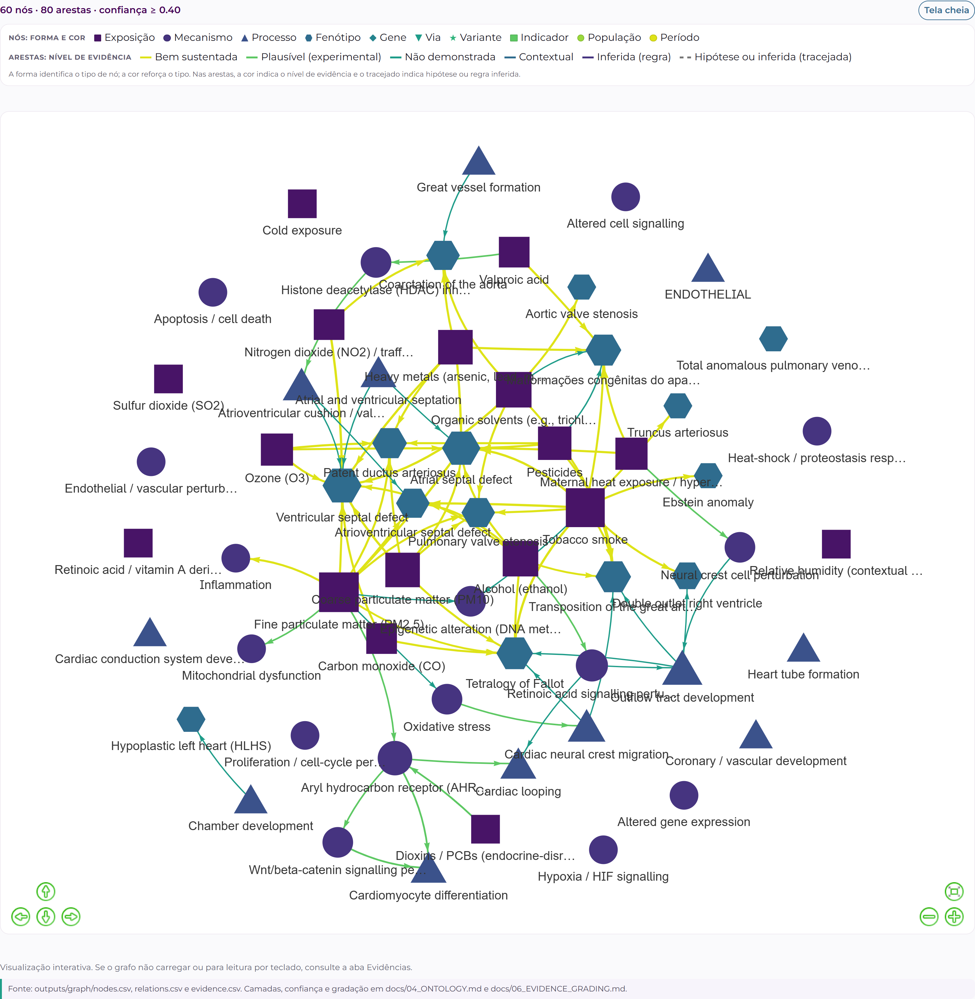
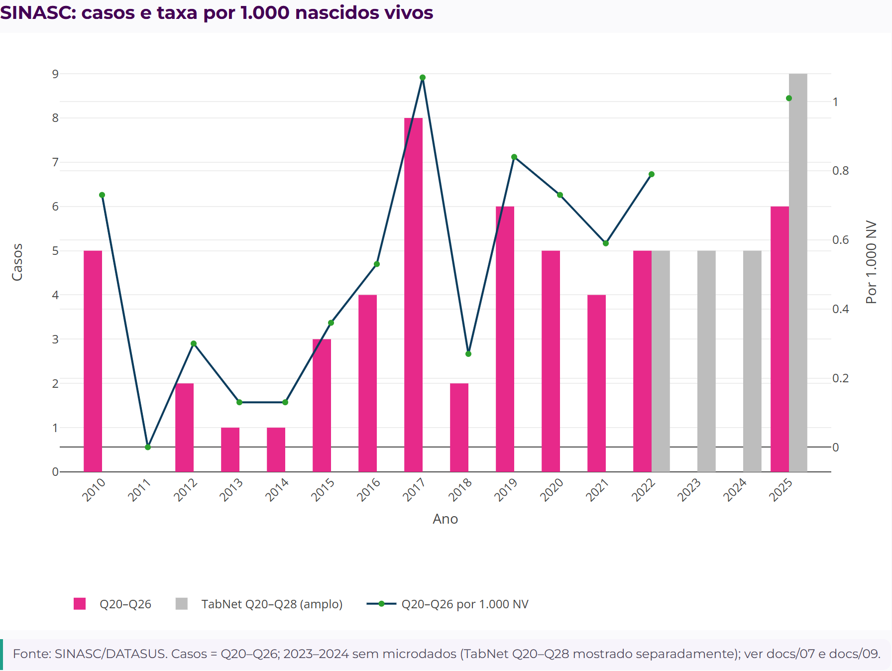
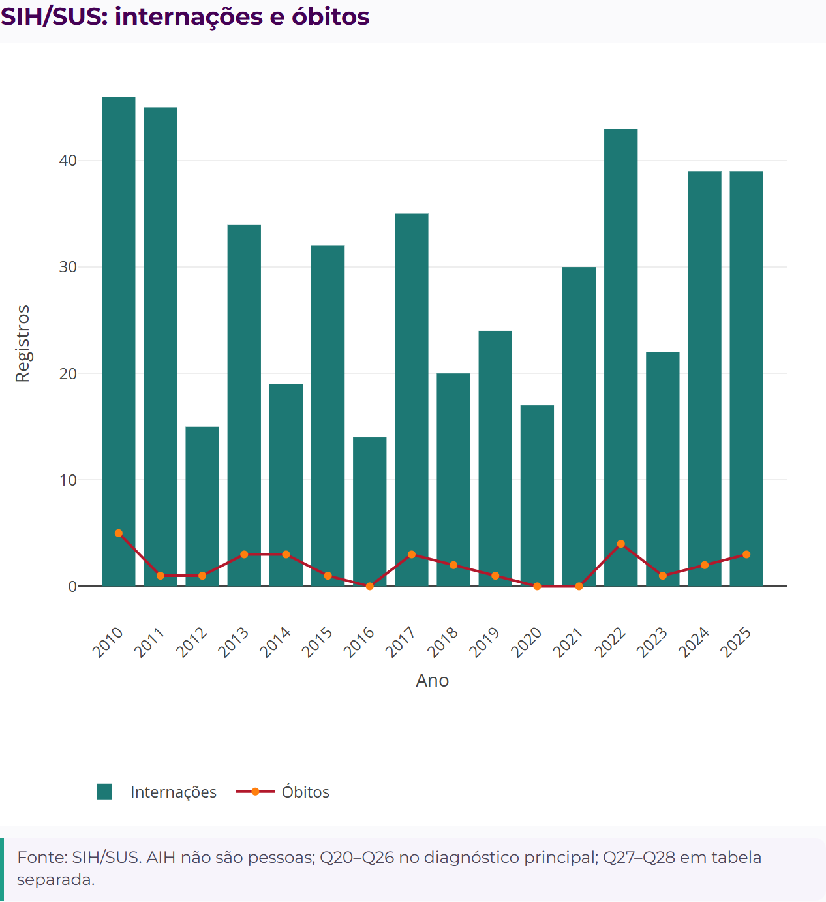
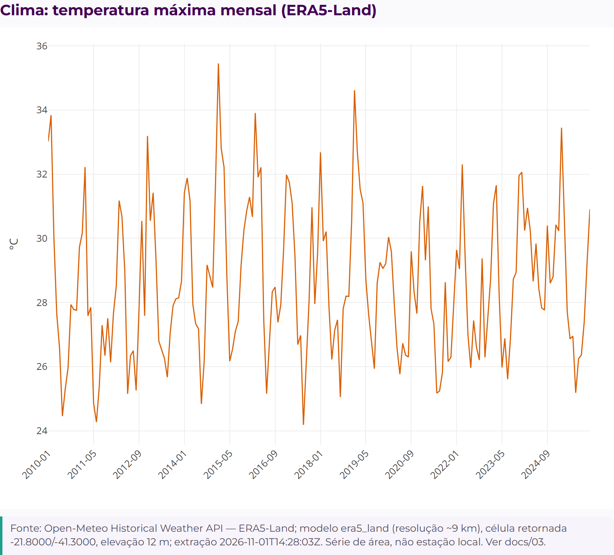
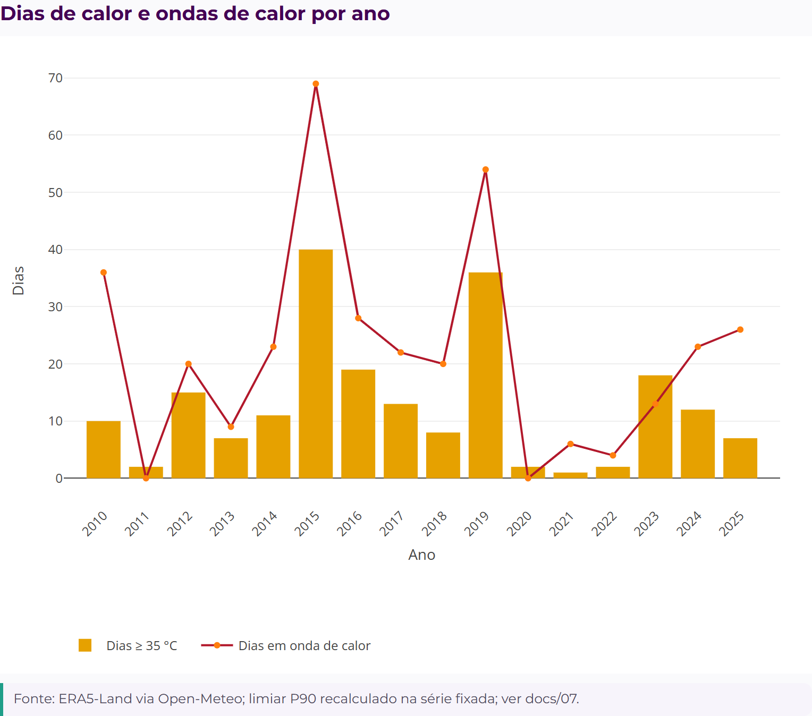
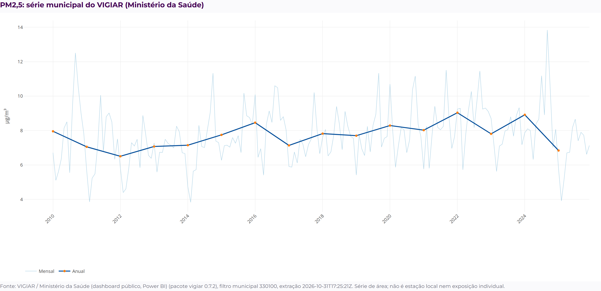
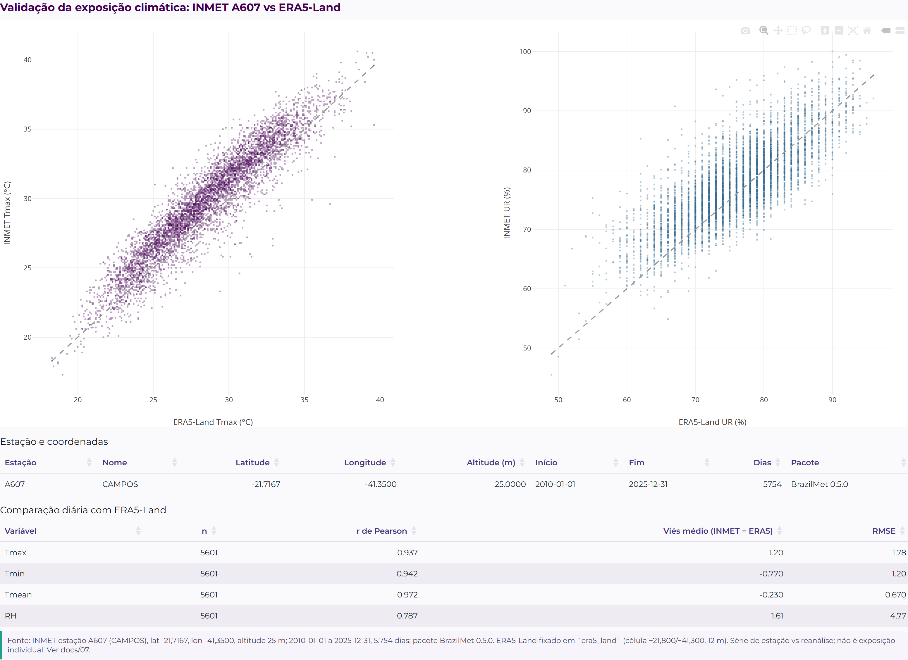

# Figuras do site GraphAmbiCardio

Gerado: 2026-11-01T21:06:49Z

Cada figura abaixo traz a fonte, o período e a nota de interpretação. Os dados usados estão em `data/`; o manifesto com SHA-256 está em `manifest.json`.

## Grafo interativo de exposições, mecanismos, processos e fenótipos

**Fonte:** outputs/graph/nodes.csv, relations.csv e evidence.csv  
**Período:** 2010–2025  
**Nota:** Camadas/confiança em docs/04_ONTOLOGY.md e docs/06_EVIDENCE_GRADING.md.  
**Dados:** data/nodes.csv, data/relations.csv, data/evidence.csv  
**SHA-256:** `adc6c3dabe776980441cc3d77bb2840155b26992440d2961178ce0c4a4c5e514`

## SINASC: casos e taxa por 1.000 nascidos vivos

**Fonte:** SINASC/DATASUS (microdados 2010–2022 e 2025; TabNet 2023–2024 em série separada)  
**Período:** 2010–2025  
**Nota:** Casos = Q20–Q26 (malformações cardíacas e dos grandes vasos); TabNet Q20–Q28 em colunas separadas; ver docs/07_EPI_ENV_METHODS.md.  
**Dados:** data/sinasc_annual.csv  
**SHA-256:** `9dc793dfd3b33ca4b847c4bea0d12e79a5bbade6cf00749cfb1a2226be61cf3f`

## SIH/SUS: internações e óbitos

**Fonte:** SIH/SUS (AIH com diagnóstico principal Q20–Q26)  
**Período:** 2010–2025  
**Nota:** AIH não são pessoas; ver docs/07 e docs/09.  
**Dados:** data/sih_annual.csv  
**SHA-256:** `1d1a7fc0a779d9e551b2239ba401793bbe30819ab0121a13a6a425e6c9b37ba6`

## Clima: temperatura máxima mensal (ERA5-Land)

**Fonte:** ERA5-Land via Open-Meteo, modelo fixado era5_land, célula −21,800/−41,300  
**Período:** 2010–2025  
**Nota:** Série de área; não é estação local. Ver docs/03_DATABASE_CATALOG.md.  
**Dados:** data/climate_monthly.csv  
**SHA-256:** `71695528b307f12f386329481c02070fd295d9878e9b0d4f54fd640a4bbdfd26`

## Dias de calor e ondas de calor por ano

**Fonte:** ERA5-Land via Open-Meteo (era5_land); limiar P90 recalculado na série fixada  
**Período:** 2010–2025  
**Nota:** Ver docs/07_EPI_ENV_METHODS.md.  
**Dados:** data/climate_annual.csv  
**SHA-256:** `6b0daf03e01f92ba5075295c92a271254e58c79502cf8b0927c4d97ed17d116e`

## PM2,5: série municipal do VIGIAR (Ministério da Saúde)

**Fonte:** VIGIAR/MS via pacote vigiar 0.7.2, filtro municipal 330100  
**Período:** 2010–2025  
**Nota:** Série de área; não é estação local nem exposição individual. Ver docs/07.  
**Dados:** data/pm25_monthly.csv, data/pm25_annual.csv  
**SHA-256:** `5c6be91c45eca46b0c5b2b46d40869c0b6e1ae522148129cfec636b73d7d65f2`

## Validação da exposição climática: INMET A607 vs ERA5-Land

**Fonte:** INMET estação A607 (lat −21,7167; lon −41,3500; alt 25 m) via BrazilMet 0.5.0; ERA5-Land via Open-Meteo  
**Período:** 2010–2025  
**Nota:** Dispersão diária; latitude, longitude, altitude, correlação, viés e RMSE nas tabelas do site. Ver docs/07.  
**Dados:** data/inmet_daily.csv, data/climate_daily.csv, data/inmet_comparison.csv  
**SHA-256:** `49c82304e2c5ade13c17dfeab94ed6cb051da068ff3635efc1eb6195e1535603`
